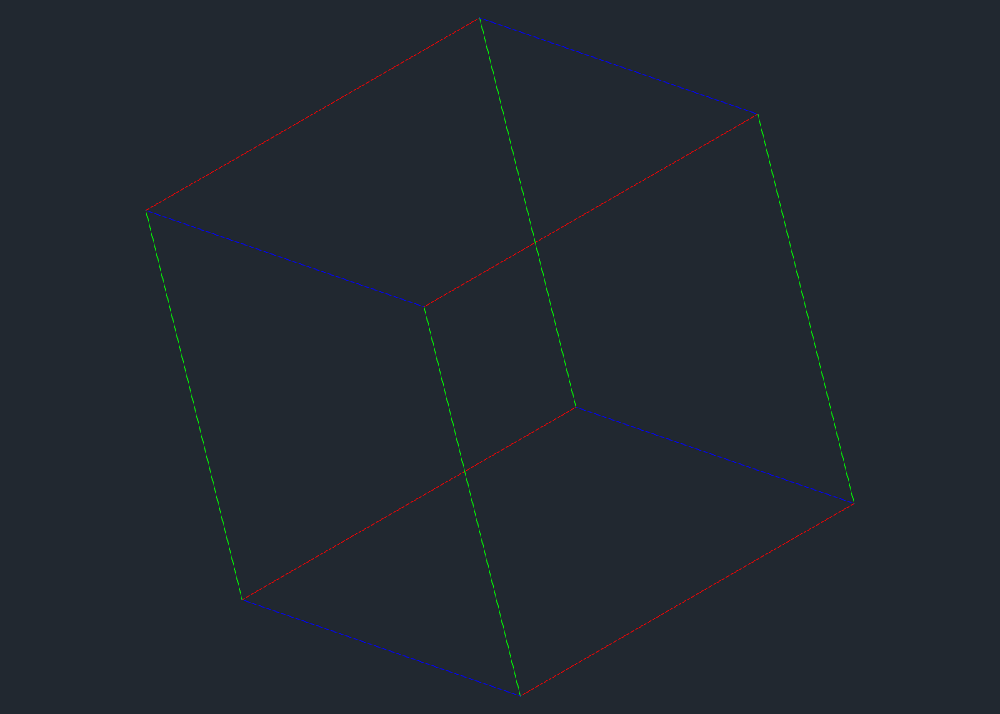
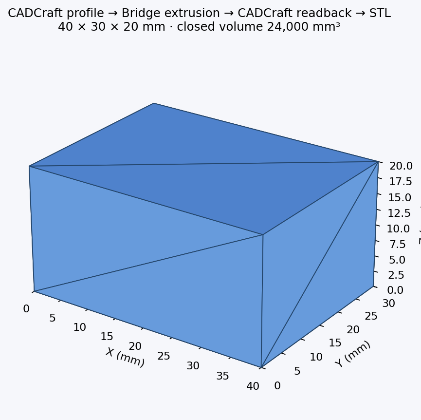

# ArtCraft Bridge — local creative app automation for AI agents

**ArtCraft Bridge connects AI agents and local automation scripts to installed ArtCraft creative applications on macOS.** Its command-line interface and Python API let an agent discover app commands, inspect documents, execute supported operations and export files through local control interfaces. It is open-source, MIT-licensed and experimental.

Use it to give an AI coding agent a practical interface to CADCraft, DesignCraft, PhotoCraft, VectorCraft, FilmCraft, LightCraft, EffectCraft and PdfCraft. Verified examples include document creation in DesignCraft and CADCraft geometry workflows with DXF persistence and bridge-assisted STL export.

Documentation updated 2026-10-11. Current bridge version **0.3.0**.

> Independent automation for ArtCraft Crafting Apps. This project is not affiliated with ArtCraft and does not use the Recraft cloud image service.

## Status and scope

Version `0.3.0` is experimental. It requires macOS, Python 3.9 or newer, and installed ArtCraft desktop apps. Its runtime uses only the Python standard library.

The bridge does not provide an MCP registration, a web API, a hosted service, or a PyPI package. Agents and scripts invoke its shell command directly. The installed apps perform their document operations. The optional CAD mesh extension computes convex extrusion and STL locally in the bridge; it makes no internet request.

Supported app identifiers are:

`photocraft`, `designcraft`, `vectorcraft`, `filmcraft`, `lightcraft`, `effectcraft`, `pdfcraft`, and `cadcraft`.

## What is ArtCraft Bridge for?

ArtCraft Bridge is a **local app automation bridge for AI agents**, built around a CLI and structured JSON results. An agent with authorized shell access can use the same commands as a human developer. Python-based agents can call the package directly. The bridge does not depend on a particular language model or AI provider.

Typical uses include:

- Letting a coding agent inspect and operate an installed creative application.
- Connecting a tool-calling AI agent to local desktop document workflows through a shell or Python tool.
- Reading app state and geometry to verify that an operation actually succeeded.
- Automating supported design, CAD and export operations with reproducible scripts.

The agent chooses the operations; the bridge handles local session control and app requests. Available features depend on the installed app version. A command catalog is discovery evidence, not proof that every creative operation works.

## How can Codex and other AI agents use ArtCraft apps?

An AI agent needs a way to execute local commands on the Mac where the ArtCraft apps are installed. Install ArtCraft Bridge there, give the agent the executable path and a dedicated workspace, and let it query the live command catalog before acting.

| Agent environment | Integration path | Evidence |
| --- | --- | --- |
| Codex with local shell access | Invoke `artcraft-bridge` or `python3 -m artcraft_bridge` as shell commands. | This project's live DesignCraft and CADCraft examples were executed from Codex on macOS. |
| Other local coding agents, including Claude Code or Gemini CLI | Invoke the same CLI when the host agent has authorized local shell access. | Intended CLI integration; these individual clients have not been integration-tested here. |
| Custom Python agents and AI tool frameworks | Import `artcraft_bridge.bridge` and expose selected functions as agent tools. | The Python API is used by the runnable CADCraft examples. Framework-specific adapters are not included. |
| Remote or chat-only assistants | Require a separate authorized execution tool on the local Mac. | ArtCraft Bridge itself provides no hosted connector or remote endpoint. |

### Agent quick start

After [installing from source](#install-from-source), an agent can start with these commands. Use the same workspace and state directory throughout the session:

```bash
artcraft-bridge --workspace "$PWD/agent-workspace" inventory
artcraft-bridge --workspace "$PWD/agent-workspace" start cadcraft
artcraft-bridge --workspace "$PWD/agent-workspace" commands cadcraft
artcraft-bridge --workspace "$PWD/agent-workspace" call cadcraft drawing.inspect \
  '{"entities": true, "limit": 100}'
```

Operational results are JSON on stdout. Errors are JSON on stderr with a nonzero exit code. An agent can inspect these results before choosing its next operation. Use the [command reference](#command-reference) and live app catalog for exact method names and parameters.

For a Python agent:

```python
from artcraft_bridge import bridge

bridge.configure(workspace="./agent-workspace")
available_apps = bridge.inventory()
bridge.start("cadcraft")
drawing = bridge.call("cadcraft", "drawing.inspect", {"entities": True, "limit": 100})
```

### Instructions you can give an AI agent

> Use ArtCraft Bridge to work with the installed ArtCraft apps on this Mac. Use a dedicated workspace, inspect the app inventory, start a managed session and read its live command catalog. Execute supported operations through the CLI or Python API. Verify results by inspecting the document and checking saved exports. Report which steps succeeded and which app capabilities are unavailable.

## Which AI-agent workflows have actually been tested?

| Workflow | Verified result | Reproducible evidence |
| --- | --- | --- |
| DesignCraft document automation | Create an A4 document, insert text, inspect it, save a native document and render PNG. | [Document example](#command-reference) and [verification record](docs/verification.md). |
| CADCraft 3D wireframe automation | Create a 40 mm XYZ cube, save/reopen DXF and verify its 12 edges and 8 vertices. | [Cube example](examples/cadcraft_cube.py) and [geometry report](docs/cadcraft-cube-verification.json). |
| CADCraft profile-to-STL workflow | Create a profile in CADCraft, extrude in the bridge, roundtrip triangular DXF faces through CADCraft and export a closed-volume STL. | [Solid example](examples/cadcraft_solid.py) and [independent STL verification](docs/cadcraft-solid-verification.json). |

These examples demonstrate local agent-driven creative automation. The STL workflow uses the bridge's convex mesh extension; CADCraft 0.5.0 has no native BRep solid kernel or STL exporter. FilmCraft and EffectCraft command discovery has been tested, but this repository does not yet demonstrate a complete video-editing workflow.

## AI integration FAQ

### Is ArtCraft Bridge an MCP server?

No. ArtCraft Bridge currently exposes a local CLI and Python API. Agents can invoke them through their existing shell or Python tools. An MCP wrapper could expose selected bridge operations, but no MCP server or automatic tool registration is included.

### Does it work with any AI model?

The bridge does not call an AI model. It is provider-independent: an agent can use it if its runtime supports authorized local shell execution or Python calls. Model-specific adapters and hosted chat integrations are not bundled.

### Does the bridge require a cloud API key?

The bridge's local control connection does not require an AI-provider API key. Your chosen AI agent and the installed ArtCraft apps have their own access requirements. Local app control does not imply that every app feature runs offline.

### Can AI agents create 3D objects and export STL with CADCraft?

The tested bridge-assisted workflow produces a closed convex triangle mesh from a straight closed CADCraft profile and exports STL. It verifies the mesh after CADCraft saves and reopens the DXF. Native CADCraft solid modeling, booleans and a general-purpose CAD kernel are not provided; see [supported mesh scope](#supported-scope).

## Install from source

Clone the repository, or download and unpack its source ZIP.

```sh
git clone https://github.com/bpnace/artcraft-bridge.git
cd artcraft-bridge
python3 -m venv .venv
.venv/bin/python -m pip install --upgrade "pip>=21.3" "setuptools>=61" wheel
.venv/bin/python -m pip install --no-build-isolation -e .
. .venv/bin/activate
```

If the editable install reports that `setuptools` is unavailable, install it in the virtual environment and rerun the install:

```sh
.venv/bin/python -m pip install setuptools
.venv/bin/python -m pip install --no-build-isolation -e .
```

After activating that environment, the installed console command is `artcraft-bridge`. The module entry point is equivalent:

```sh
artcraft-bridge --version
python3 -m artcraft_bridge --version
```

For a source checkout without installation, run the module with its source directory on `PYTHONPATH`:

```sh
PYTHONPATH=src python3 -m artcraft_bridge --version
```

## Configuration

Global options must precede the subcommand. Environment variables provide the same defaults.

| Option | Environment variable | Default | Purpose |
| --- | --- | --- | --- |
| `--apps-dir DIR` | `ARTCRAFT_BRIDGE_APPS_DIR` | `/Applications` | Directory containing the ArtCraft `.app` bundles. |
| `--workspace DIR` | `ARTCRAFT_BRIDGE_WORKSPACE` | Current directory | Directory where app-visible output is created. |
| `--state-dir DIR` | `ARTCRAFT_BRIDGE_STATE_DIR` | `~/Library/Application Support/artcraft-bridge` | Private bridge state, profiles, tokens, locks, and launch records. |

Command-line options override environment variables. A managed session is tied to its launch workspace and app directory; incompatible reuse is rejected. Use the original options to stop it, or a separate `--state-dir` for independent configurations. Use a dedicated workspace for automation runs. The bridge creates `outputs/` inside that workspace for files it writes or exposes to apps.

Example with explicit, portable locations:

```sh
artcraft-bridge --apps-dir /Applications --workspace "$PWD" start designcraft
```

## Command reference

Operational commands write structured JSON to standard output. Errors are JSON on standard error with a nonzero exit status; help and version output are plain text. Use `--timeout SECONDS` with `call`; the value must be greater than zero and no more than `55`.

| Command | Result |
| --- | --- |
| `inventory` | Lists supported apps and reports whether their bundles are present under `--apps-dir`. |
| `start APP` | Starts an isolated managed app session, or reuses a healthy session that this bridge previously started. |
| `inspect APP` | Reads the current UI state from a managed session. |
| `commands APP` | Returns the app's current command catalog. Query this before invoking app-specific actions. |
| `call APP METHOD [JSON]` | Sends an app method with an optional JSON object parameter. |
| `call APP METHOD --params-file FILE` | Reads the JSON object parameter from `FILE`. Use this for nontrivial parameters and file paths. |
| `stop APP` | Requests a safe stop for a session owned by this bridge. |
| `cad-extrude --height N --units mm --name NAME` | Extrudes a supported CADCraft profile in the bridge and writes STL plus triangular DXF; use `--handle HANDLE` for a drawing with multiple entities. |
| `cad-export-stl --units mm --name NAME` | Writes STL from the current CADCraft convex closed triangular face mesh. |

Typical read-only sequence:

```sh
artcraft-bridge start designcraft
artcraft-bridge inspect designcraft
artcraft-bridge commands designcraft
artcraft-bridge stop designcraft
```

For most apps, `inspect` calls `ui.inspect`, `commands` calls `engine.commands`, and application actions use `engine.execute`. PdfCraft uses JSON-RPC methods such as `ui.state`, `ui.commands`, `ui.command`, and `ui.open` instead. The catalog returned by `commands` is authoritative for the installed app version.

### Passing parameters safely

The positional `JSON` argument and `--params-file` must contain a JSON object. Put parameters in a file when a command writes to the workspace. This avoids shell escaping errors and makes the destination absolute before it reaches the app.

The following DesignCraft example creates an A4 document, adds a text frame, inspects it, and saves it under the current workspace's `outputs/` directory. These create, text, inspect, and save operations were exercised against the prototype. Run it only in a workspace where you want that document created.

```sh
bridge() { artcraft-bridge --workspace "$PWD" "$@"; }

bridge start designcraft

python3 - <<'PY'
import json
from pathlib import Path

outputs = Path.cwd().resolve() / "outputs"
outputs.mkdir(parents=True, exist_ok=True)

requests = {
    "design-new.json": {
        "command": "file.new",
        "params": {"preset": "A4", "title": "artcraft-bridge example"},
    },
    "design-text.json": {
        "command": "frame.create",
        "params": {
            "rect": [36, 36, 500, 100],
            "content": "text",
            "text": "artcraft-bridge controls a local ArtCraft session.",
        },
    },
    "design-save.json": {
        "path": str(outputs / "artcraft-bridge-example.designcraft"),
    },
    "design-render.json": {
        "path": str(outputs / "artcraft-bridge-example.png"),
        "page": 0,
        "scale": 1,
    },
}

for name, request in requests.items():
    (outputs / name).write_text(json.dumps(request) + "\n", encoding="utf-8")
PY

bridge call designcraft engine.execute --params-file outputs/design-new.json
bridge call designcraft engine.execute --params-file outputs/design-text.json
bridge call designcraft document.inspect '{}'
bridge call designcraft app.save --params-file outputs/design-save.json
bridge call designcraft ui.render --params-file outputs/design-render.json
bridge stop designcraft
```

The `app.save` and `ui.render` methods were also exercised against the prototype. `ui.render` writes the first page as a PNG preview. No edited document or generated image is bundled in this repository.

## PdfCraft requires an explicit portable copy

PdfCraft starts only when `--portable-copy` is supplied:

```sh
artcraft-bridge start pdfcraft --portable-copy
```

The bridge copies the user-installed PdfCraft bundle into its private state directory, adds its portable marker and data directory, runs `xattr -cr` on that copy, and ad-hoc signs that copy. It never clears attributes or signs the original bundle under `--apps-dir`.

Stopping PdfCraft also requires an explicit acknowledgement:

```sh
artcraft-bridge stop pdfcraft --allow-empty-pdf-termination
```

Before sending `SIGTERM`, the bridge reads PdfCraft state and refuses to continue unless `documents` is exactly `[]`; it also verifies that the process is the bridge-owned process. This is a safety check, not a transaction: a person can open or change a document after the check and before termination. Do not interact with the PdfCraft window during that short interval.

## Safety and behavior

- `start` only controls sessions that it created and recorded. It does not adopt ordinary app windows.
- A response timeout or closed control connection can leave an edit's result unknown. Inspect state before retrying; the bridge does not automatically retry a mutation.
- Some UI methods require an unobscured foreground app. If a call waits for a visible window, bring the app forward, for example `open -a DesignCraft`, then inspect state before attempting another mutation.
- For apps other than PdfCraft, `stop` requests the app's quit method. A save prompt remains open and the bridge does not force-kill the app.
- Local control channels are intended for the same machine. Some app protocols do not authenticate every connection. Keep state files private and do not expose local control ports.
- PhotoCraft and VectorCraft receive automation roots limited to the configured workspace and its `outputs/` directory. Those roots do not create a security sandbox, and the other apps do not receive that enforcement.

## CADCraft 3D cube — verified live



The image above is CADCraft's own `ui.render` output. The bridge created a real **3D wireframe cube** in CADCraft 0.5.0, saved it as DXF, reopened that DXF in CADCraft, and verified its geometry again.

- **12** entities of type `3D Polyline`, with **8** distinct XYZ vertices.
- Every edge is **40 mm** long; every vertex joins three edges.
- All expected coordinates survive saving and reopening, including **8 distinct Z levels**.
- The drawing uses metric units (`$INSUNITS = 4`).
- The native preview is **1400 × 1000** pixels.

This is a wireframe object, not a solid, a watertight surface mesh or a 3D-printable STL. The tested 0.5.0 command catalog exposes `3dpoly`, but no box, extrusion or solid-modeling command. CADCraft renders the drawing in its XY view; the cube's XYZ coordinates are rotated so this projection shows the shape. The projection is not evidence of a full 3D camera or solid renderer.

Run the same verified example from an installed source checkout, with a **fresh dedicated workspace**:

```sh
python3 examples/cadcraft_cube.py --workspace "$PWD/cadcraft-demo"
```

The example writes `outputs/artcraft-cube-40.dxf`, `outputs/artcraft-cube-40.png` and `outputs/cadcraft-cube-verification.json` under that workspace. It verifies geometry before saving and after reopening, refuses to overwrite existing example files or edit a reused managed session, and leaves the saved drawing visible. To close that managed test session:

```sh
artcraft-bridge --workspace "$PWD/cadcraft-demo" stop cadcraft
```

Use the same `--state-dir` for the example and subsequent CLI calls if you chose a custom one. See the [example source](examples/cadcraft_cube.py) and the [recorded verification result](docs/cadcraft-cube-verification.json). The report contains no local absolute paths or control tokens.

## Closed volume and STL — bridge extension



**Verified in CADCraft 0.5.0 on 2026-10-11.** A 40 × 30 mm closed polyline was drawn in CADCraft. The bridge extruded its live coordinates by 20 mm into a closed convex triangle boundary, imported those twelve `3DFACE` triangles into CADCraft, saved and reopened the DXF, then wrote STL from CADCraft's inspected face coordinates. The exported block encloses **24,000 mm³**, with eight vertices and dimensions **40 × 30 × 20 mm**.

Independent validation with trimesh 4.12.2 reports `is_watertight`, `is_winding_consistent` and `is_volume` all true, Euler characteristic 2 and the expected dimensions and volume. The image above is an independent plot of the exported STL, not CADCraft's viewport. See the [recorded result](docs/cadcraft-solid-verification.json).

### What runs where

CADCraft owns the source profile and the imported DXF triangle faces. **ArtCraft Bridge performs extrusion and STL serialization.** The app has no native `box`, `extrude` or `exportstl` command in the tested 341-command catalog. This produces a genuine closed mesh boundary enclosing a volume, not a CADCraft BRep/ACIS solid. CADCraft displays face edges in XY projection; it does not provide a shaded 3D solid viewport. [Upstream format limitations](https://github.com/storytold/cadcraft/blob/main/docs/file-format-parity.md) and [roadmap](https://github.com/storytold/cadcraft/blob/main/ROADMAP.md) describe the missing native 3D/STL work.

### Reproduce the complete live test

From an installed source checkout, use a fresh dedicated workspace and a new managed session:

```bash
python3 examples/cadcraft_solid.py --workspace "$PWD/cadcraft-solid-demo"
```

The example saves the original profile, exports a bridge STL and 3DFACE DXF, imports the latter into CADCraft, saves/reopens it and exports `outputs/block-cadcraft-reopened.stl` from the reopened faces. It leaves the saved mesh drawing open. It refuses nonempty output directories and reused managed sessions. Use `--state-dir DIR` consistently for independent sessions.

### Use your own profile

Create a closed straight lightweight polyline in the managed CADCraft drawing, then run:

```bash
artcraft-bridge --workspace "$PWD/my-cad-project" cad-extrude \
  --height 20 --units mm --name my-part
```

This writes `outputs/my-part.stl` and `outputs/my-part.dxf`, without replacing the open drawing. If the drawing contains several entities, select the source with `--handle HANDLE` from `drawing.inspect`. Coordinates must explicitly be interpreted as millimetres; STL itself carries no unit field. Existing output files are never overwritten.

To import the generated face mesh into CADCraft, use `app.open` with its absolute DXF path. You can then save/reopen it through the normal bridge calls. To export the current CADCraft face mesh:

```bash
artcraft-bridge --workspace "$PWD/my-cad-project" cad-export-stl \
  --units mm --name my-part-from-cadcraft
```

### Supported scope

The dependency-free exporter accepts simple strictly convex closed profiles made of straight segments and a positive extrusion height. Mesh export accepts convex closed consistently oriented triangular `3DFACE` boundaries. Holes, concave outlines, curved/bulged segments, wide polylines, quads, booleans, bevels and native solid entities are rejected. It checks nondegenerate triangles, paired opposite edge directions, convex boundary planes and positive volume. This is a bounded extrusion/export tool, not a general CAD kernel. The live sample passes independent topology/volume checks; no physical print was performed.

## Migration from 0.1.0

Version 0.1.0 used the mistaken name `recraft-bridge`. Version 0.2.0 uses **ArtCraft Bridge** throughout:

| 0.1.0 | 0.2.0 |
| --- | --- |
| `recraft-bridge` CLI / distribution | `artcraft-bridge` |
| `recraft_bridge` Python module | `artcraft_bridge` |
| `RECRAFT_BRIDGE_*` variables | `ARTCRAFT_BRIDGE_*` |
| `~/Library/Application Support/recraft-bridge` | `~/Library/Application Support/artcraft-bridge` |

Close old bridge-managed sessions with the old CLI and their original workspace before upgrading. Uninstall the old distribution, install the new one, and update scripts, environment variables and repository remotes. Old state is not migrated or deleted automatically. The existing `v0.1.0` tag and release remain historical artifacts under their original package name.

## Observed prototype evidence

The prototype successfully started or reused, queried, and stopped these locally installed versions. The catalog count shows that the catalog was returned; it does not prove every listed action works.

| App | Observed version | Catalog entries |
| --- | ---: | ---: |
| PhotoCraft | 0.7.0 | 858 |
| DesignCraft | 0.6.0 | 555 |
| VectorCraft | 0.9.0 | 992 |
| FilmCraft | 0.6.0 | 693 |
| LightCraft | 0.6.0 | 453 |
| EffectCraft | 0.8.0 | 669 |
| PdfCraft | 0.6.0 | 185 |
| CADCraft | 0.5.0 | 341 |

Installed app versions and catalogs can differ. Run `commands APP` against the target Mac before relying on an action.

## Test

Run the package test suite from the repository root:

```sh
PYTHONPATH=src python3 -m unittest discover -s tests -v
```

See [the architecture document](docs/architecture.md) for the session, transport, and safety model.

## License

The bridge code and documentation are licensed under the [MIT License](LICENSE). ArtCraft applications and any imported or exported media retain their own licensing terms; see [THIRD_PARTY_NOTICES.md](THIRD_PARTY_NOTICES.md).

## Further documentation

- [Architecture and protocol boundaries](docs/architecture.md)
- [Verification evidence](docs/verification.md)
- [Versioning and release procedure](VERSIONING.md)
- [Changelog](CHANGELOG.md)
- [Contributing](CONTRIBUTING.md)
- [External applications and protocol references](THIRD_PARTY_NOTICES.md)
