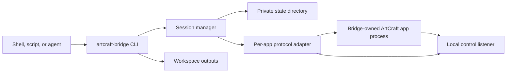
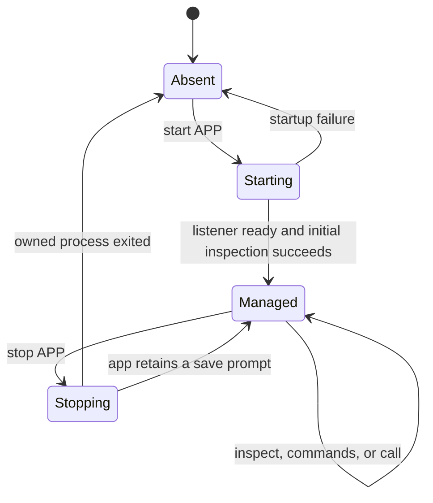

# Architecture

## Purpose

`artcraft-bridge` is a local macOS command-line adapter between a shell caller and installed ArtCraft Crafting Apps. It makes a small, explicit lifecycle available to scripts and agents:

1. Start a bridge-owned app session.
2. Discover its state and command catalog.
3. Invoke one documented app method with a bounded request.
4. Stop the same session safely.

It is not a remote service, an MCP server, or a replacement for the apps' own automation protocols. The bridge is independent of the Recraft cloud AI image service and has no official affiliation with ArtCraft or Recraft.

## Components



| Component | Responsibility |
| --- | --- |
| CLI | Parses global options and subcommands, validates input, and prints JSON results. `inventory` reads bundle presence and version metadata without starting an app. |
| Session manager | Creates and reuses bridge-owned sessions, serializes lifecycle operations, and validates process identity. |
| Per-app adapter | Selects the app's control protocol, authentication sequence, and app-specific lifecycle behavior. |
| Workspace | Holds caller-visible output under `outputs/`. It defaults to the current directory. |
| State directory | Holds private session records, profile data, token material, locks, and logs. It defaults to `~/Library/Application Support/artcraft-bridge`. |
| Installed app | Runs with its normal local control implementation and performs the actual document operation. |

## Configuration boundary

The bridge resolves three roots before it starts an app.

| Root | Default | Effect |
| --- | --- | --- |
| Apps directory | `/Applications` | Locates the installed ArtCraft application bundles. |
| Workspace | Current directory | Provides the caller's output location and automation working context. |
| State directory | `~/Library/Application Support/artcraft-bridge` | Separates bridge runtime state from the project workspace. |

`--apps-dir`, `--workspace`, and `--state-dir` take precedence over `ARTCRAFT_BRIDGE_APPS_DIR`, `ARTCRAFT_BRIDGE_WORKSPACE`, and `ARTCRAFT_BRIDGE_STATE_DIR` respectively. Callers should keep the state directory private because it can contain app-control tokens.

## Session lifecycle



`start APP` checks for an installed bundle and reuses a healthy matching recorded session. Before a new launch it checks running app executable paths across profiles and ordinary GUI instances; by default another instance is rejected. Explicit `--allow-multiple` permits an intentional parallel session. It then creates an isolated profile, starts the app with its local control option, waits for the listener, and records the session. A subsequent start can reuse the recorded session only after validating that the recorded process still has the expected identity and that the configured workspace and app directory match its launch record. A configuration mismatch is rejected rather than starting a duplicate session.

The bridge does not take over an application that was started normally. This prevents a command from unexpectedly operating on a person's existing desktop session.

Lifecycle operations and calls for the same app are serialized with a per-session lock. Starts additionally hold one stable private per-user/app lock under `~/Library/Application Support/artcraft-bridge/launch-locks`, independent of a custom state directory. This prevents concurrent bridge starts across separate state roots from bypassing duplicate discovery. External tools and manual launches do not participate in that lock; window interaction can still race bridge operations.

## Request transport

Most supported apps use newline-delimited JSON request and response frames on a local TCP listener. A request has an identifier, method, and JSON object parameters. The bridge accepts only the response with its request identifier and rejects malformed, oversized, incomplete, or error responses.

For those apps, the common method mapping is:

| CLI action | Typical app method |
| --- | --- |
| `inspect APP` | `ui.inspect` |
| `commands APP` | `engine.commands` |
| `call APP engine.execute …` | `engine.execute` |

PdfCraft uses JSON-RPC framing and its own UI method names. The CLI maps its inspect and catalog commands to `ui.state` and `ui.commands`; callers use `ui.command`, `ui.open`, and other methods returned by PdfCraft's catalog.

PhotoCraft and PdfCraft require the local token material created for the managed session. Other protocols may be unauthenticated even though their listener is local. The bridge treats every control response as untrusted protocol data and bounds request size, response size, and total request time.

`call` accepts a JSON object directly or through `--params-file`. It applies one deadline to connect, authentication, sending, and reading. The configured deadline must be at most 55 seconds.

## Mutation uncertainty

Desktop control transports cannot always say whether an operation completed before a connection closed or a deadline expired. A timeout after request transmission therefore has an ambiguous result.

The bridge does not replay an edit automatically. The safe caller sequence is:

1. Call `inspect APP` or an app-specific read method.
2. Determine whether the intended change already happened.
3. Retry only if the observed app state proves it did not happen.

This policy matters most for document creation, saving, exporting, and UI commands that may have started before the response was lost.

## App-specific behavior

### Standard sessions

The bridge launches a fresh profile for managed standard sessions. `stop` sends the app's quit method and waits briefly for the owned process to exit. A save dialog is intentional: the bridge leaves the app open and reports that it did not stop instead of forcing process termination.

### PdfCraft sessions

PdfCraft has a separate lifecycle because it needs a portable bundle configuration and the observed version does not provide a suitable quit method.

`start pdfcraft --portable-copy` performs this sequence:

1. Copy the installed PdfCraft bundle into the private state directory.
2. Create the portable marker and portable data directory in that copy.
3. Clear extended attributes with `xattr -cr` on the copy.
4. Ad-hoc sign only the copied bundle.
5. Start the copied bundle and discover its local JSON-RPC control endpoint.

The original installed bundle is never altered by those operations.

`stop pdfcraft --allow-empty-pdf-termination` first reads `ui.state` and requires `documents` to equal `[]`. It then rechecks that the process identity matches the bridge-owned session before sending `SIGTERM`. The state check and signal are separate operations, so a person who opens a document in between can race this guard. Do not use the PdfCraft window during shutdown.

## File access model

The workspace makes outputs easy to collect, but it is not an application sandbox. PhotoCraft and VectorCraft are started with read and write automation roots based on the workspace and its `outputs/` directory. These roots constrain those apps' automation interfaces only. Other supported apps do not provide the same enforced roots, and normal macOS permissions still apply to every process.

The bridge does not claim that an app cannot access other files, contact a network, or show a native file dialog. Those behaviors belong to the installed app and its configuration.

## Observed compatibility evidence

The predecessor prototype successfully connected to all eight target apps, collected their catalogs, and shut down the bridge-managed instances. It observed the following versions and catalog counts: PhotoCraft 0.7.0 (858), DesignCraft 0.6.0 (555), VectorCraft 0.9.0 (992), FilmCraft 0.6.0 (693), LightCraft 0.6.0 (453), EffectCraft 0.8.0 (669), PdfCraft 0.6.0 (185), and CADCraft 0.5.0 (341).

The DesignCraft flow that created an A4 document, inserted text, read it back, saved it, and rendered a PNG preview was exercised as an end-to-end document operation. Version 0.2.0 also verifies CADCraft 3D polyline cube creation, DXF save/reopen and rendering, as detailed in [verification.md](verification.md). Version 0.3.0 adds a bridge-owned convex extrusion mesh path, CADCraft 3DFACE import/save/reopen and STL export from the reopened faces. The app itself has no BRep kernel or STL exporter. The extension lives in `solid.py`; the CLI exposes `cad-extrude` and `cad-export-stl`, requires explicit mm units and refuses output overwrite. Other catalog entries remain discovery evidence, not a statement that every action was tested.

## Validation

The package test command is:

```sh
PYTHONPATH=src python3 -m unittest discover -s tests -v
```

Unit tests cover the bridge behavior without requiring the desktop apps. A full app integration run still needs the target ArtCraft apps installed on a macOS host and should use a dedicated workspace and state directory.

## Non-goals for v0.3.0

- No MCP server registration or native tool registration.
- No HTTP, hosted, or remote-control API.
- No PyPI publication.
- No claim of an official ArtCraft or Recraft affiliation.

Version 0.4.0 adds duplicate-launch prevention and a separate dependency-free rocket example. The rocket example writes a nonconvex radial mesh and STL outside the CADCraft kernel and roundtrips its faces through CADCraft. It does not change the convex-only core exporter. See [eight live workflows](app-tests.md) and [current verification](verification.md).
